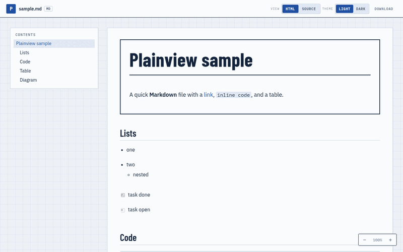
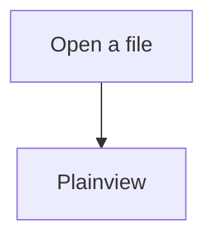
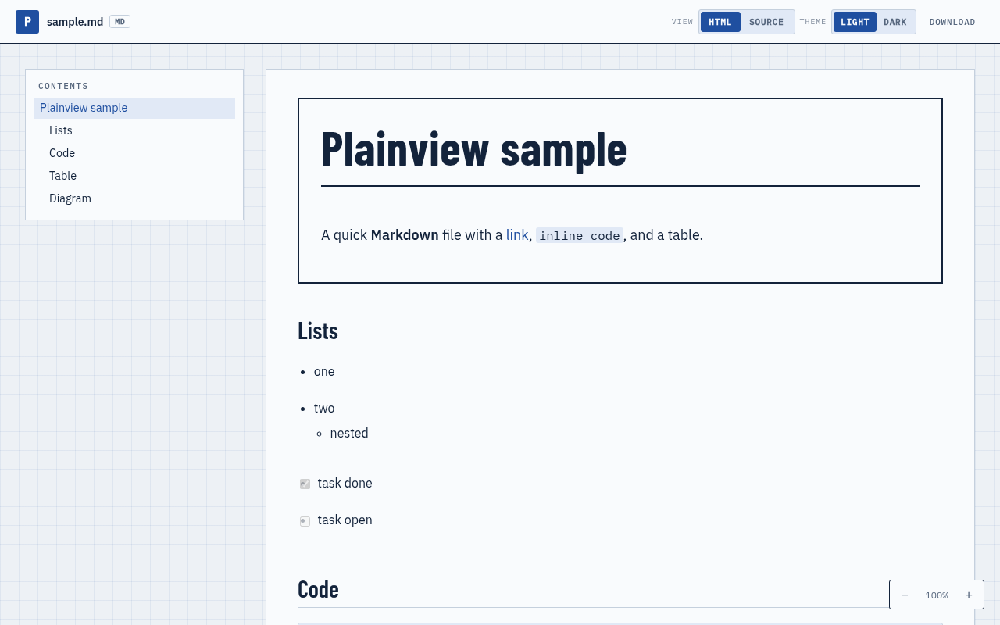
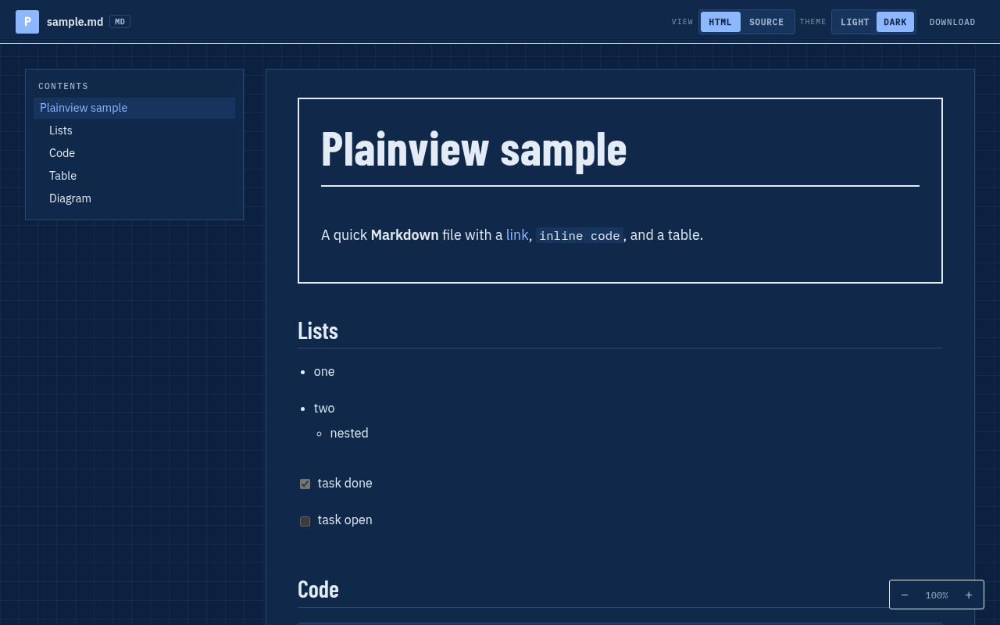
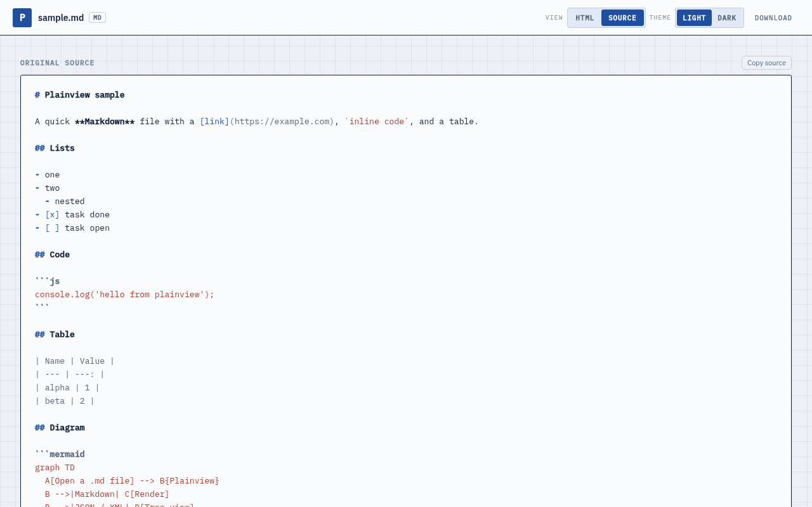
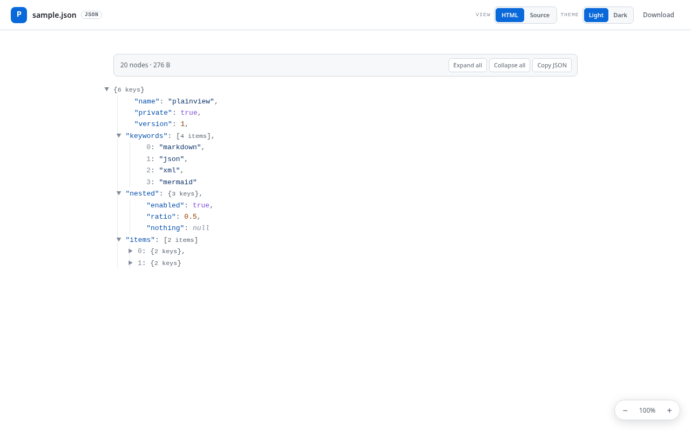
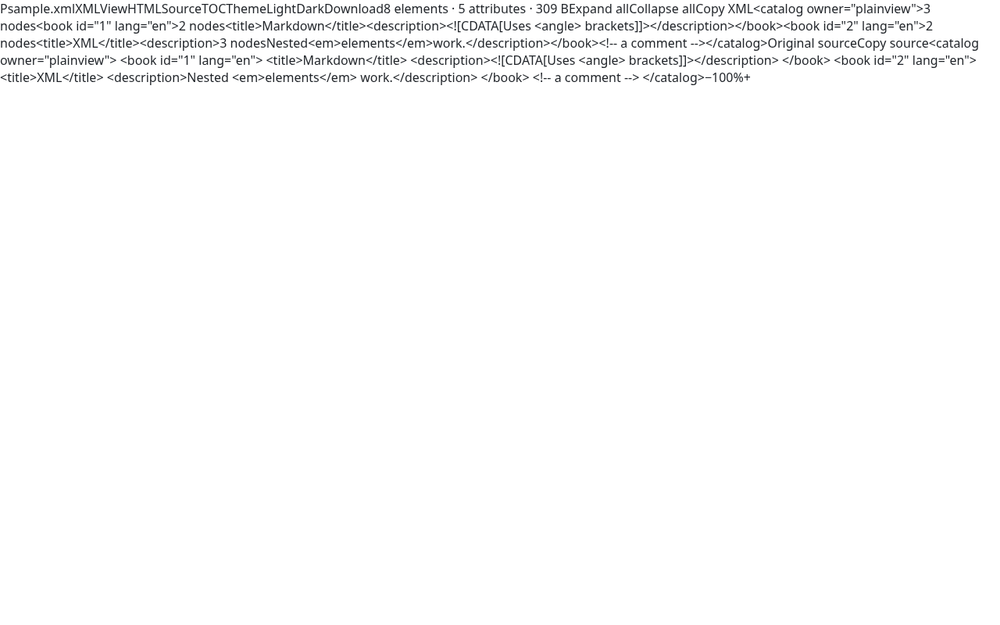

# Plainview

**A reader for the plain-text files your browser normally shows raw.**
Markdown, JSON and XML today; YAML, TOML and more are on the roadmap.

[](https://github.com/kk18888678/plainview/actions/workflows/ci.yml)
[](LICENSE)

> Private alpha · version **0.2.3** · Chrome Web Store and Firefox Add-ons listings pending.



GitHub READMEs do not have a native carousel, so the animated preview above cycles the screenshots.
A full gallery is below.

## What it renders

| Format | Detection | View |
|---|---|---|
| Markdown | `.md`, `.markdown`, `.mdown`, `.mkd`, `.mkdn`, `.mdwn`, `.mdx`; `text/markdown` | GFM/CommonMark HTML, contents panel, code copy, Mermaid diagrams |
| JSON | `.json`, `.jsonc`, `.geojson`, `.jsonld`, `.har`, `.webmanifest`; `application/json` and `+json` types | Collapsible tree, JSONC comments/trailing commas, expand/collapse, copy |
| XML | `.xml`, `.rss`, `.atom`, `.rdf`, `.opml`, `.wsdl`, `.plist`, `.xsl`, `.xslt`; `application/xml`, `text/xml` and `+xml` types | Collapsible element tree with attributes, text, CDATA, comments |

The Markdown view also supports Mermaid fenced blocks:

````markdown

````

Mermaid is loaded only on documents that contain a Mermaid block.

## What it renders

| Format | Detection | View |
|---|---|---|
| Markdown | `.md`, `.markdown`, `.mdown`, `.mkd`, `.mkdn`, `.mdwn`, `.mdx`; `text/markdown` | GFM/CommonMark HTML, table of contents, code copy, Mermaid diagrams |
| JSON | `.json`, `.jsonc`, `.geojson`, `.jsonld`, `.har`, `.webmanifest`; `application/json` and `+json` types | Collapsible tree, JSONC comments/trailing commas, expand/collapse, copy |
| XML | `.xml`, `.rss`, `.atom`, `.rdf`, `.opml`, `.wsdl`, `.plist`, `.xsl`, `.xslt`; `application/xml`, `text/xml` and `+xml` types | Collapsible element tree with attributes, text, CDATA, comments |

The Markdown view also supports Mermaid fenced blocks:

````markdown

````

Mermaid is loaded only on documents that contain a Mermaid block.

## Features

- **HTML and Source views.** The selected view is saved per document; a reload returns to it.
- **Reading position.** Every document remembers its scroll position; a reload returns to it.
- **Light and Dark themes.** The selected theme is saved. There is no Auto mode.
- **Content zoom.** `−` / `+` changes the rendered type size without touching the browser zoom.
  `Ctrl/Cmd` + `+`, `-`, `0` and `Ctrl/Cmd` + wheel also work in the HTML view.
- **Source view.** Markdown, JSON and XML source are syntax-highlighted, use the full width, and
  have a **Copy source** button.
- **Download.** The top bar downloads the original file as-is.
- **Optional download auto-open.** In Settings, choose whether a finished supported download should
  open in a new Plainview tab. Off by default.
- **No remote resources.** marked, Mermaid and the fonts are packaged; nothing is fetched to render.
- **Contents panel.** The current section is highlighted while reading; clicking an item lands the
  heading below the sticky bar.
- **Settings page.** Click the toolbar icon for the download auto-open option and OS file-association
  instructions.

## Screenshots

| Markdown | Dark theme | Source |
|---|---|---|
|  |  |  |

| JSON | XML |
|---|---|
|  |  |

## Opening files from the browser

A browser extension cannot change the operating system's default app. Clicking an already-downloaded
`.md` file in your file manager still uses whatever text editor the OS has configured. To make the
browser handle those clicks, set the OS association for `.md`, `.json` and `.xml` to Chrome or
Firefox. The Settings page includes Linux, Windows and macOS instructions.

The optional **Open supported downloads in Plainview** setting only handles *new* downloads: when a
supported file finishes downloading, Plainview opens it in a new tab. It does not affect files you
click later.

Local `file://` documents also need file access: Chrome’s **Allow access to file URLs**, or Firefox’s
permanent install plus **Access your data for file:// URLs** in `about:addons`.

## Build and install

```bash
git clone https://github.com/kk18888678/plainview.git
cd plainview
npm install
npm run build
```

This creates two unpacked extensions:

```text
dist/chrome/     load in chrome://extensions → Developer mode → Load unpacked
dist/firefox/    load in about:debugging → This Firefox → Load Temporary Add-on
```

For Chrome, open the Plainview card in `chrome://extensions` and enable **Allow access to file URLs**
so local files are picked up. Firefox 142 or newer is required. Full install and troubleshooting
steps are in [docs/INSTALL.md](docs/INSTALL.md).

**Firefox local files:** temporary add-ons loaded through `about:debugging` do not receive
`file://` access in current Firefox. For local files, install the signed add-on permanently, then
open `about:addons` → Plainview → **Permissions** and enable **Access your data for file:// URLs**.
Drag/open the `.md` file again afterwards. HTTP-hosted documents work with a temporary add-on.

The built extension is versioned in `src/manifest.json`; the build copies the version from
`package.json`.

Package both stores:

```bash
npm run package
# dist/plainview-chrome-<version>.zip
# dist/plainview-firefox-<version>.zip
```

## Test

```bash
npm test
```

The 20 Playwright tests load the built Chrome extension, render Markdown/JSON/XML fixtures,
exercise Mermaid, source highlighting, copy, download, settings, theme/view/scroll persistence, zoom,
the Contents highlight and unsafe Markdown.

Install the test browser once:

```bash
npx playwright install chromium
npm test
```

If `PLAYWRIGHT_BROWSERS_PATH` is set (for example in the Nix shell), Playwright uses that browser
instead.

Firefox has been smoke-tested with the packaged ZIP: Markdown, Mermaid, source view, theme and XML
work; JSON opens in Firefox's native JSON viewer because Firefox does not inject content scripts
into that privileged viewer. Firefox lint:

```bash
npm run build
npm run lint:firefox
```

`web-ext lint` reports 0 errors; the remaining warnings are vendored Mermaid `innerHTML`/lazy
`import()` notices.

## How it is built

```text
src/manifest.json          extension manifest
src/content.js             format detection and mount
src/formats.js             format registry and MIME/extension matching
src/document.js            raw-document source extraction and the XML HTML shell
src/markdown-core.js       marked + HTML escaping + URL sanitising
src/markdown-enhance.js    code blocks, tables, heading ids and Mermaid placeholders
src/title-block.js         visual H1 + first paragraph box
src/background.js          optional download auto-open and toolbar settings entry
src/options.html/js/css    settings page and OS file-association help
src/json-parse.js          JSON/JSONC parser
src/json-view.js           JSON tree
src/xml-parse.js           XML parser
src/xml-render.js          XML tree
src/xml-view.js            XML document
src/source-highlight-*.js  Markdown/JSON/XML source highlighting
src/mermaid.js             lazy Mermaid loader and renderer
src/svg-sanitize.js        second-pass SVG sanitiser
src/topbar.js              top bar and HTML/Source + theme controls
src/toc.js                 Contents panel and scroll spy
src/zoom.js                content zoom
src/theme.js               light/dark theme
src/view-switcher.js       HTML/Source view and view persistence
src/scroll-memory.js       reading-position persistence
src/ui.js                  mount and wiring
src/styles/               the HTML visual theme, data trees, source tokens
scripts/build.mjs          builds dist/chrome and dist/firefox, patches Mermaid for Firefox CSP
scripts/package.mjs        creates the Chrome and Firefox ZIP files
scripts/screenshots.mjs    creates the store screenshots
scripts/test.mjs           runs the Playwright suite with the local browser path
store/                     store listing, privacy policy, screenshots and release checklist
```

The HTML view uses a visual language adapted from the design-doc Blueprint theme: the page grid,
paper surfaces, condensed headings, mono labels and blue/red accents. It does not generate
design-document components such as sheet indexes, title-block metadata or status pills.

## Safety

- Raw HTML in Markdown is escaped, not executed.
- Links are limited to `http`, `https`, `mailto` and `file`; images also allow raster `data:` URIs.
- Mermaid runs with `securityLevel: 'strict'` and its SVG is sanitised again before insertion.
- XML is parsed with `DOMParser`; scripts, external entities and XSLT are not executed by the viewer.
- The Firefox content-script CSP blocks `Function("return this")` used by a Mermaid chunk; the build
  rewrites that one lodash expression to `globalThis`.

## Roadmap

The format layer is deliberately pluggable. YAML, TOML, CSV/TSV and JSON5 are natural next formats;
see [ROADMAP.md](ROADMAP.md).

## Known limits

- Raw HTML, MDX/JSX and YAML/TOML are not rendered; MDX files fall back to Markdown with JSX shown as
  text.
- Very large JSON/XML trees stop at 40,000 nodes; the Source view has the full file.
- Source highlighting is skipped above 1.5 MB and the source is shown as plain text.
- A server that forces a download (`Content-Disposition: attachment`) never opens a page, so the
  extension cannot render it. Open the downloaded file locally instead.
- Firefox provides its own JSON viewer. Plainview does not replace it, so Firefox users get the
  native JSON tree rather than Plainview's tree.
- Firefox temporary add-ons cannot read `file://` documents. A permanently installed/signed add-on
  with the file-URL permission enabled can.
