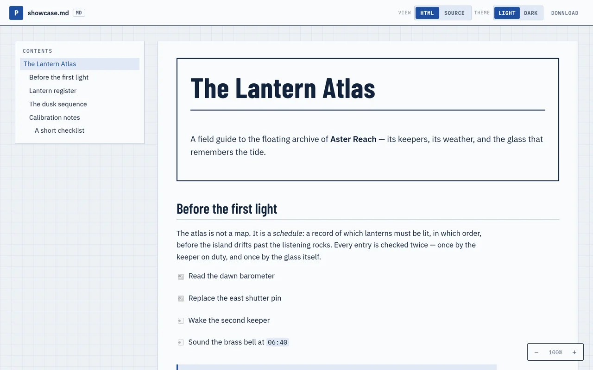
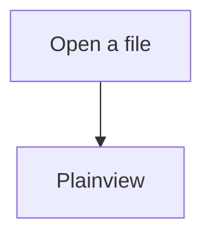
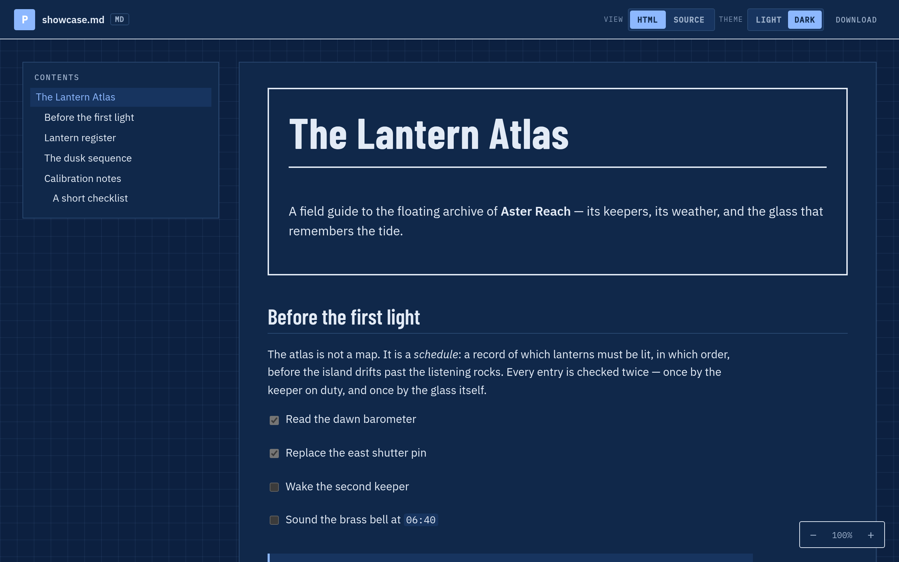
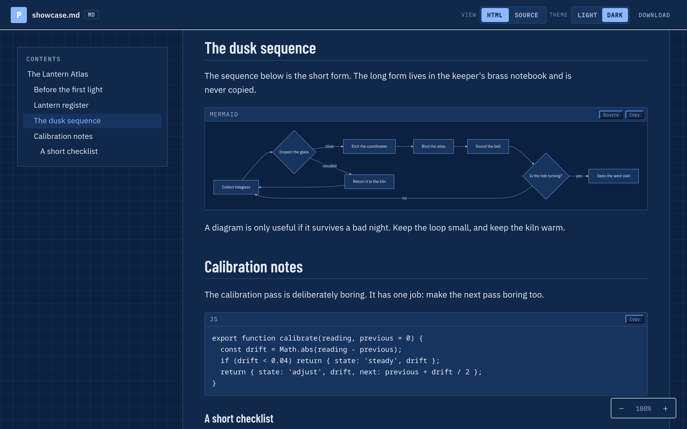
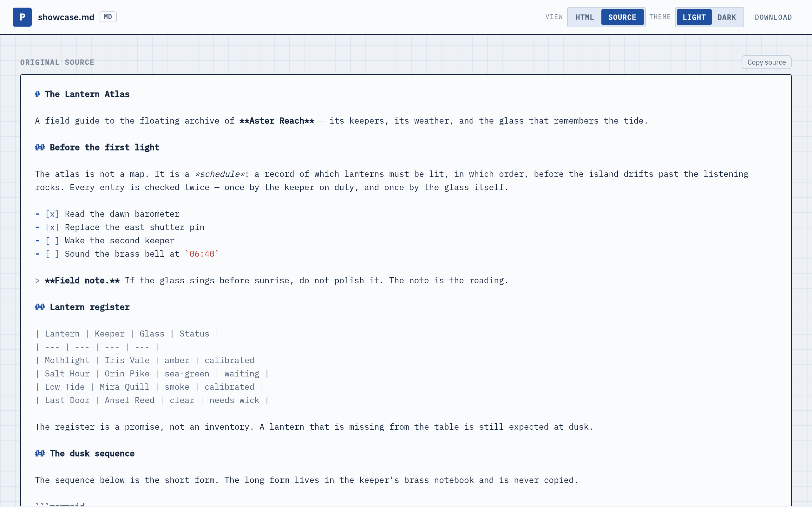
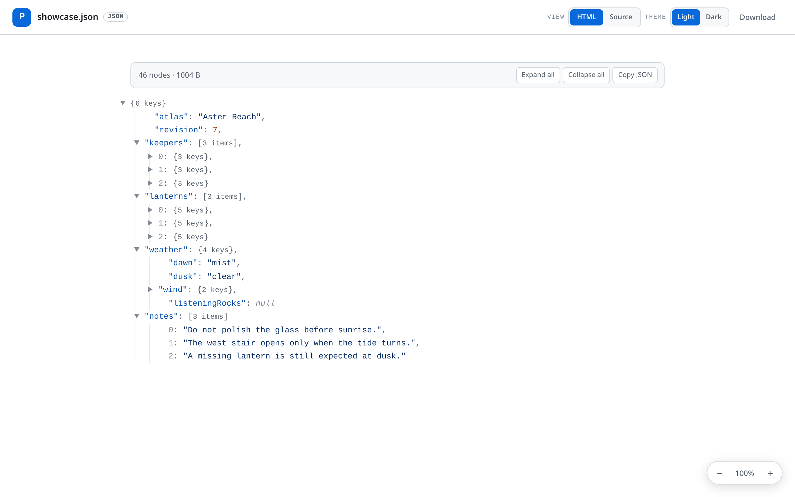
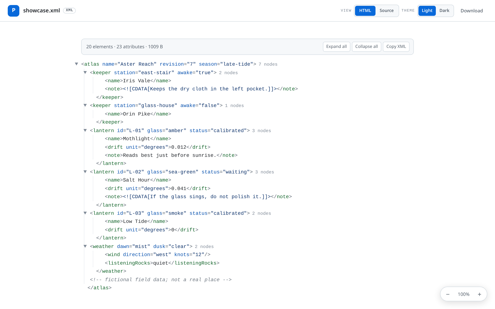

# Plainview

**A reader for the plain-text files your browser normally shows raw.**
Markdown, JSON, YAML, TOML, CSV/TSV and XML.

[](https://github.com/KKhosla7/plainview/actions/workflows/ci.yml)
[](LICENSE)

> Version **1.1.0** · Chrome Web Store and Firefox Add-ons listings pending.



GitHub READMEs do not have a native carousel, so the animated WebP above cycles the screenshots.
The full gallery below uses 2560×1600 lossless PNGs; the animated preview is compressed for size.

## What it renders

| Format | Detection | View |
|---|---|---|
| Markdown | `.md`, `.markdown`, `.mdown`, `.mkd`, `.mkdn`, `.mdwn`, `.mdx`; `text/markdown` | GFM/CommonMark HTML, contents panel, code copy, Mermaid diagrams |
| JSON | `.json`, `.jsonc`, `.geojson`, `.jsonld`, `.har`, `.webmanifest`; `application/json` and `+json` types | Collapsible tree, JSONC comments/trailing commas, expand/collapse, copy |
| XML | `.xml`, `.rss`, `.atom`, `.rdf`, `.opml`, `.wsdl`, `.plist`, `.xsl`, `.xslt`; `application/xml`, `text/xml` and `+xml` types | Collapsible element tree with attributes, text, CDATA, comments |

The Markdown view also supports Mermaid fenced blocks:

````markdown

````

Mermaid is loaded only on documents that contain a Mermaid block.

## Features

- **HTML and Source views.** The selected view is saved per document; a reload returns to it.
- **Reading position.** Every document remembers its scroll position; a reload returns to it.
- **Light and Dark themes.** The selected theme is saved. There is no Auto mode.
- **Content zoom.** `−` / `+` changes the rendered type size without touching the browser zoom.
  `Ctrl/Cmd` + `+`, `-`, `0` and `Ctrl/Cmd` + wheel also work in the HTML view.
- **Source view.** Markdown, JSON and XML source are syntax-highlighted, use the full width, and
  have a **Copy source** button.
- **Local exports.** Save clean native data or a self-contained HTML reader.
- **No remote resources.** marked, Mermaid and the fonts are packaged; nothing is fetched to render.
- **Contents panel.** The current section is highlighted while reading; clicking an item lands the
  heading below the sticky bar.
- **Settings page.** Click the toolbar icon for reader, rendering and export settings.
- **Update notice.** After an extension update, Plainview shows a one-time browser notification
  linking to the release notes and marks the toolbar icon until Settings is opened.

## Performance

Normal pages load only a tiny loader (`boot.js`, about 3 KB minified) and the stylesheet (about
28 KB minified). The reader bundle (`app.js`, about 116 KB minified) is imported only after a
Markdown, JSON or XML document is detected. Mermaid (about 2.8 MB) and the local fonts (about 296 KB)
remain lazy. Browsing ordinary sites does not parse marked, the JSON/XML renderers or Mermaid.

## Screenshots

| Markdown | Dark theme | Mermaid |
|---|---|---|
|  |  |  |

| Source | JSON | XML |
|---|---|---|
|  |  |  |

## Opening files from the browser

A browser extension cannot change the operating system's default app. Clicking an already-downloaded
`.md` file in your file manager still uses whatever text editor the OS has configured. To make the
browser handle those clicks, set the OS association for `.md`, `.json` and `.xml` to Chrome or
Firefox. Use Ctrl/Cmd+O or drag a supported file into the browser.

Downloaded files are saved normally by the browser. Open a downloaded file in Plainview when you
want to read it.

Local `file://` documents also need file access: Chrome’s **Allow access to file URLs**, or Firefox’s
permanent install plus **Access your data for file:// URLs** in `about:addons`.

## Build and install

```bash
git clone https://github.com/KKhosla7/plainview.git
cd plainview
npm install
npm run build
```

This creates two unpacked extensions:

```text
dist/chrome/     load in chrome://extensions → Developer mode → Load unpacked
dist/firefox/    load in about:debugging → This Firefox → Load Temporary Add-on
```

For Chrome, open the Plainview card in `chrome://extensions` and enable **Allow access to file URLs**
so local files are picked up. Full install and troubleshooting steps are in
[docs/INSTALL.md](docs/INSTALL.md).

## Firefox setup

Firefox 142 or newer is required.

### Temporary add-on (HTTP / HTTPS)

Open `about:debugging#/runtime/this-firefox` → **Load Temporary Add-on** and select
`dist/firefox/manifest.json`. This is enough for documents served over `http` or `https`.

Temporary add-ons **cannot read local `file://` documents** in current Firefox.

### Local files (permanent install)

1. Sign the Firefox ZIP through AMO (`web-ext sign`, or upload it to addons.mozilla.org).
2. Install the signed XPI.
3. Open `about:addons` → Plainview → **Permissions**.
4. Enable **Access your data for file:// URLs**.
5. Open or drag the local `.md`, `.json` or `.xml` file again.

Firefox’s native JSON viewer handles `application/json` and Firefox does not inject content scripts
into that privileged viewer. Plainview leaves it in place; Markdown and XML use Plainview. This is
also listed under [Known limits](#known-limits).

The built extension is versioned in `src/manifest.json`; the build copies the version from
`package.json`.

## Package and release assets

```bash
npm run package
# dist/plainview-chrome-<version>.zip
# dist/plainview-firefox-<version>.zip
# dist/plainview-<version>-source.zip
```

The GitHub release workflow attaches all three. The source ZIP is generated with
`git archive` from the tagged commit.

## Code style

Formatting and review standards live in [STYLE.md](STYLE.md). Biome 2.6.7 enforces all non-nursery
rules; `npm run lint` fails on any diagnostic, including informational suggestions. The configuration
is in [biome.json](biome.json).

## Test

```bash
npm run lint
npm test
```

The 20 Playwright tests load the built Chrome extension, render Markdown/JSON/XML fixtures,
exercise Mermaid, source highlighting, copy, download, settings, theme/view/scroll persistence, zoom,
the Contents highlight and unsafe Markdown.

Install the test browser once:

```bash
npx playwright install chromium
npm test
```

If `PLAYWRIGHT_BROWSERS_PATH` is set (for example in the Nix shell), Playwright uses that browser
instead.

Firefox has been smoke-tested with the packaged ZIP: Markdown, Mermaid, source view, theme and XML
work; JSON opens in Firefox's native JSON viewer because Firefox does not inject content scripts
into that privileged viewer. Firefox lint:

```bash
npm run build
npm run lint:firefox
```

`web-ext lint` reports 0 errors; the remaining warnings are the bundled lazy imports and vendored
Mermaid `innerHTML` notices.

## How it is built

```text
src/manifest.json          extension manifest
src/boot-entry.js          tiny every-page detector bundle entry
src/app-entry.js           reader bundle entry (imported only for supported documents)
src/boot.js                detection + lazy app.js import
src/background.js          download auto-open, settings entry, update notice
src/app/                   reader shell, top bar, Contents, zoom, theme
src/core/                  dom, formats, document, xml shell, settings, clipboard, download,
                           fonts, scroll utilities and reading-position memory
src/formats/markdown/      marked, code/tables/headings, visual title block
src/formats/json/          JSON/JSONC parser and tree
src/formats/xml/           XML parser, tree renderer and document
src/formats/mermaid/       lazy Mermaid loader and SVG sanitiser
src/formats/source/        Markdown/JSON/XML source highlighters
src/formats/shared/        data toolbar and error panel
src/options/               settings page and OS file-association help
src/styles/                HTML theme, data trees, source tokens, layout
src/fonts/                 local WOFF2 files and OFL licences
vendor/                    Mermaid chunks; marked is bundled into app.js
scripts/build.mjs          esbuild bundles boot.js/app.js/ styles.css, patches Mermaid
scripts/package.mjs        creates Chrome, Firefox and source ZIP files
scripts/screenshots.mjs    creates the high-res gallery and animated preview
scripts/test.mjs           runs the Playwright suite with the local browser path
store/                     store listing, privacy policy, screenshots and release checklist
```

The HTML view uses a technical-document visual language: the page grid, paper surfaces,
condensed headings, mono labels and blue/red accents. It does not generate document components such
as sheet indexes, title-block metadata or status pills.

## Safety

- Raw HTML in Markdown is escaped, not executed.
- Links are limited to `http`, `https`, `mailto` and `file`; images also allow raster `data:` URIs.
- Mermaid runs with `securityLevel: 'strict'` and its SVG is sanitised again before insertion.
- XML is parsed with `DOMParser`; scripts, external entities and XSLT are not executed by the viewer.
- The Firefox content-script CSP blocks `Function("return this")` used by a Mermaid chunk; the build
  rewrites that one lodash expression to `globalThis`.

## Roadmap

The format layer is deliberately pluggable. YAML, TOML, CSV/TSV and JSON5 are natural next formats;
see [ROADMAP.md](ROADMAP.md).

## Known limits

- Raw HTML, MDX/JSX and YAML/TOML are not rendered; MDX files fall back to Markdown with JSX shown as
  text.
- Large JSON trees render small pages and open only the branches you use; search covers the full document in batches. XML trees stop at 40,000 rendered nodes; the Source view has the full file.
- Source highlighting is skipped above 1.5 MB and the source is shown as plain text.
- A server that forces a download (`Content-Disposition: attachment`) never opens a page, so the
  extension cannot render it. Open the downloaded file locally instead.
- Firefox provides its own JSON viewer. Plainview does not replace it, so Firefox users get the
  native JSON tree rather than Plainview's tree.
- Firefox temporary add-ons cannot read `file://` documents. A permanently installed/signed add-on
  with the file-URL permission enabled can.
