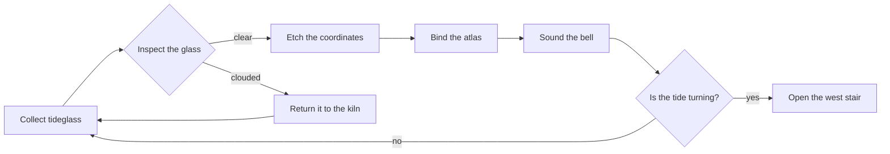

# The Lantern Atlas

A field guide to the floating archive of **Aster Reach** — its keepers, its weather, and the glass that remembers the tide.

## Before the first light

The atlas is not a map. It is a *schedule*: a record of which lanterns must be lit, in which order, before the island drifts past the listening rocks. Every entry is checked twice — once by the keeper on duty, and once by the glass itself.

- [x] Read the dawn barometer
- [x] Replace the east shutter pin
- [ ] Wake the second keeper
- [ ] Sound the brass bell at `06:40`

> **Field note.** If the glass sings before sunrise, do not polish it. The note is the reading.

## Lantern register

| Lantern | Keeper | Glass | Status |
| --- | --- | --- | --- |
| Mothlight | Iris Vale | amber | calibrated |
| Salt Hour | Orin Pike | sea-green | waiting |
| Low Tide | Mira Quill | smoke | calibrated |
| Last Door | Ansel Reed | clear | needs wick |

The register is a promise, not an inventory. A lantern that is missing from the table is still expected at dusk.

## The dusk sequence

The sequence below is the short form. The long form lives in the keeper's brass notebook and is never copied.



A diagram is only useful if it survives a bad night. Keep the loop small, and keep the kiln warm.

## Calibration notes

The calibration pass is deliberately boring. It has one job: make the next pass boring too.

```js
export function calibrate(reading, previous = 0) {
  const drift = Math.abs(reading - previous);
  if (drift < 0.04) return { state: 'steady', drift };
  return { state: 'adjust', drift, next: previous + drift / 2 };
}
```

### A short checklist

1. Wipe the lens with the **dry** cloth.
2. Compare the reading with the previous entry, not with the weather.
3. Write the drift in the margin in pencil.
4. Only then touch the brass screw.

The atlas is finished when the keepers stop arguing about the order of the first three lanterns. It has not happened yet.
