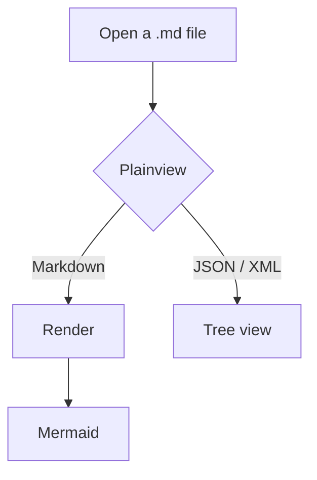

# Plainview sample

A quick **Markdown** file with a [link](https://example.com), `inline code`, and a table.

## Lists

- one
- two
  - nested
- [x] task done
- [ ] task open

## Code

```js
console.log('hello from plainview');
```

## Table

| Name | Value |
| --- | ---: |
| alpha | 1 |
| beta | 2 |

## Diagram



> Rendered locally. No network calls for the document itself.
